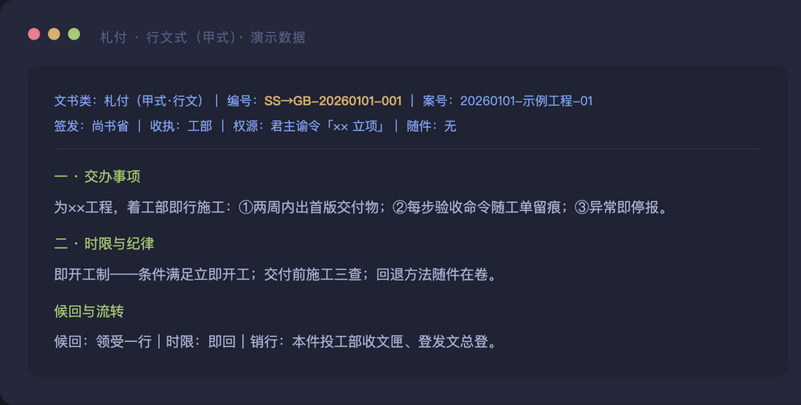
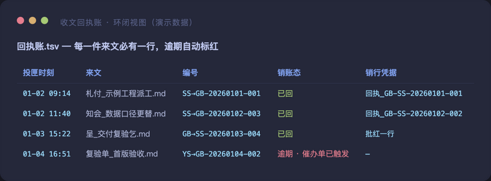

# 三省六部 · 多智能体朝廷运营框架

> 把一个多智能体协作体系，按中国古代三省六部制组织成一座真正「运转起来」的朝廷——不是架构图，是运营实录。

**这不是又一个 Agent 框架 demo。** GitHub 上的「朝廷项目」大多是架构展示：画一张官制图，摆几个角色卡。这一座不同——它照着这套制度**真实运营了两个月**，留下五百余件公文、逐日台账、完整的收发文回执链。你看到的第一行 README，就是这座朝廷里工部（工程衙门）在夜班里写出来的。

## 为什么是「朝廷」

多智能体协作最常见的死法：**人人都能干活，没人对结果负责；事事都在对话里，无一字留在卷宗里。** 三省六部制恰好是古人给「大型组织分工协作」打磨了一千多年的答案：

- **决策、审核、执行三权分立**（中书立案 → 门下审核 → 尚书执行）——天然对应 proposal / review / delivery；
- **六部归口**——按产出物性质定主管衙门，职责不明零容忍；
- **一纸公文走天下**——所有跨衙协作走统一公文制，有事卷可查，无事不扰；
- **皇帝亲握关键权柄**（发布、付费、删除、任命），其余工序各级自主——授权清晰，边界分明。

LLM Agent 的「会话易散、上下文易失」顽症，被三件器物治住：**卷宗落盘**（聊天易散，札卷长存）、**回执账制**（每一件来文必有一行回执，逾期自动催办）、**收班交割**（每班收尾写交接卷，新班开机自领读）。

## 快速一览

```
你（陛下）
  ├── 中书省 ── 立案定标：目标 / 非目标 / 验收基线
  ├── 门下省 ── 审核：合规红线 / 口径矛盾 / 方案风险
  ├── 尚书省 ── 交付总调度：派工 / 批红 / 台账 / 限期核销
  └── 六部（按产出物归口）
        ├── 吏部 ── 典章制度与技能库
        ├── 户部 ── 资源与资金产线
        ├── 礼部 ── 人情往来与对外关系
        ├── 兵部 ── 发布纪律与平台观察
        ├── 刑部 ── 独立验证：数字互证 / 开奖核销
        └── 工部 ── 技术建设：内容 / 代码 / 系统 / 工具
        + 御史台 ── 察政：事故审计 / 越权抽查
```

一套公文三种式样（行文式 / 知照式 / 留档式）、四段定骨（结论 → 分衙列札 → 附报 → 下步）、出件六查机检（编号 / 头七行 / 收执唯一 / 候回节 / 四段骨 / 投匣登行）——**格式即纪律，纪律即可审计。**

版式一览（脱敏演示数据）：

| 公文 · 行文式 | 回执账 · 环闭视图 | 公告板 · 收班一行 |
|---|---|---|
|  |  |  |

## 这个仓库里有什么

| 路径 | 内容 |
|---|---|
| `docs/00-快速上手.md` | 一个下午把朝廷跑起来的最小路径 |
| `docs/01-朝廷总纲.md` | 官制三层（岗位-职责-工具）与立制三策 |
| `docs/02-公文制度.md` | 公文三式、四段骨、出件六查、回执账制 |
| `docs/03-运行机制.md` | 即开工制、收班交割、巡账催办、收班哨 |
| `docs/岗位示例/` | 三个代表性岗位的完整职责卡与提示词范式 |
| `docs/公文模板/` | 开工读匣 / 收班交割 / 回执——拿走即用 |
| `assets/screenshots/` | 公文与台账版式实录（脱敏演示数据） |
| `建仓命令.sh` | 一键建仓脚本（配合你的 Git 平台） |

## 适合谁

- **一个人指挥多个 AI 会话干活**——你就是陛下，这套制度替你把「派活、催活、验收、追责」全部制度化；
- **小团队想把 AI 协作从「聊天」升级为「运营」**——公文制 + 回执账 = 天然的管理留痕；
- **想在开源 Agent 项目里引入组织结构**——三省六部是一套现成的、经过实战的角色拓扑。

## 完整版

本仓库公开的是**方法论骨架**：官制、公文制、运行机制与岗位范式。完整运营版额外包含：

- 各衙门**完整章程**与职守细则（含踩坑修订记录）；
- **催办单 / 复验单 / 呈审单 / 会签** 等十余种进阶文书式样；
- 账册体系（发文总登 / 回执账 / 隔离区制度）的完整运营数据；
- 两月运营中的**事故复盘卷宗**（覆写事故、越权察责、流程精简）与对应的制度修补实录。

如需完整版或交付辅导（帮你把朝廷在本团队落地），直接联系我们：

- **微信**：`datawhy2026`
- **邮箱**：13560079276@163.com
- **公众号**：治数量化（运营实录与方法论长文首发地）

也可 [提个 Issue](https://github.com/daowhy/sansheng-liubu/issues/new) 说明你的团队规模与场景，通常 48 小时内回复。

## 边界声明（open-core 铁律）

本仓库只含**通用方法论**：制度、格式、工作法、岗位范式。不含任何真实业务数据、内部系统信息与凭据；所有截图均为脱敏演示数据。示例中的运营叙事（公文件数、衙门设置）为真实统计，具体公文内容一律不公开。

## License

待定（见 建仓命令.sh 注释）——MIT / Apache-2.0 均可，按发布者选择。
